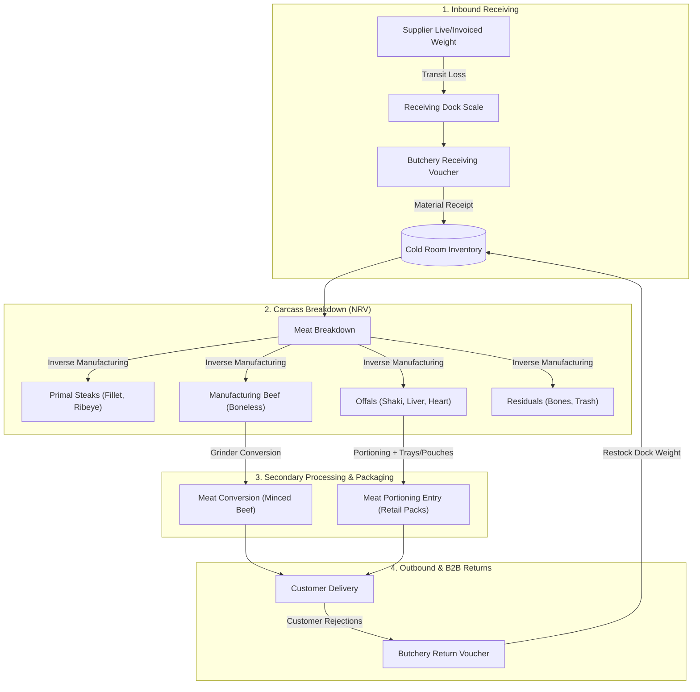

# Butchery Management System — Comprehensive User & Operational Guide

> [!NOTE]
> **Application Name:** `butchery_management`  
> **Platform:** ERPNext / Frappe Framework (v15+)  
> **Primary Workspace:** **Butchery** (Desk)  
> **Target Industry:** Meat Processing, Abattoir Operations, Commercial Butcheries & Cold-Chain Meat Retailers  

---

## 1. Executive Overview & Architecture

### The Unique Nature of Meat Processing
Standard manufacturing systems assume an **assembly model** (many raw ingredients combine into one finished product). Butchery and meat processing operate on an **inverse / disassembly model** (one biological organism converts into dozens of distinct sellable cuts, by-products, and trimmings).

Meat processing introduces critical physical and accounting challenges:
1. **Biological Mass Balance & Moisture Shrinkage**: Carcasses lose fluid during transport and chilling. Evaporative cooling, trimming loss, and grinder residue represent physical mass discrepancies that must be reconciled.
2. **Cost Joint Allocation (Net Realizable Value - NRV)**: A 300kg carcass purchased at a single flat price per kilogram yields high-value cuts (Ribeye, Fillet @ ₦14,000–₦15,000/kg) alongside low-value cuts (Bones, Offals, Trimmings @ ₦500–₦3,000/kg). Flat cost averaging would distort profit margins. The system implements dynamic **Net Realizable Value (NRV)** weighting to distribute carcass acquisition costs across all cuts.
3. **End-to-End Batch Traceability**: Complete auditability from live animal purchase voucher to receiving dock, deboned child cut batches, converted minced batches, packaged retail packs, and B2B customer deliveries.



---

## 2. System Configuration & Master Data Setup

Before running transactions, ensure the following core masters are established.

### 2.1 Butchery Settings
Navigate to: **Butchery > Items & Master Data > Butchery Settings** (Single DocType).

| Setting Field | Description | Recommended Default |
|---|---|---|
| **Max Allowable Receiving Shortage %** | Threshold percentage before transit weight loss triggers operational escalation. | `2.50%` |
| **Max Allowable Cutting Loss %** | Permissible moisture/trimming shrinkage during deboning. | `3.50%` |
| **Default Transit Loss Account** | Expense GL account for unabsorbed transit shrinkage. | `5111 - Cost of Goods Sold - Meat Variance` |
| **Default Cutting Loss Account** | Expense GL account for excessive deboning loss. | `5112 - Production Shrinkage & Loss` |
| **Default Return Loss Account** | Expense GL account for transit shrinkage on customer returns. | `5113 - Customer Return Transit Shortage` |

---

### 2.2 Item Master Setup
All meat items belong to the Item Group **`Meat & Butchery Products`**.

> [!IMPORTANT]
> Ensure all meat items have:
> * **`Is Stock Item`**: Checked (`1`)
> * **`Default Unit of Measure`**: `Kg` for bulk/primal items; `Nos` or `Pack` for portioned items.
> * **`Has Batch No`**: Checked (`1`) — essential for traceability and FIFO costing.

#### Item Categories Seeded in the System:
1. **Parent Carcasses**: `Whole Beef Carcass`, `Goat Carcass`, `Pork Carcass`.
2. **Steak / Primal Cuts**: `Beef Fillet`, `Ribeye`, `Sirloin Beef`, `T-Bone`, `Tomahawk Beef`, `Minute Steak`.
3. **Manufacturing & Table Cuts**: `Boneless Beef`, `Minced Beef`, `Beef Topside`, `Silver Side Beef`, `Beef Tonzo`, `Stewing Pack`, `Beef Shin`, `Shredded Beef`, `Beef Cube`, `Beef Sausage`.
4. **Offals & Direct Cow Cuts**: `Ponmo`, `Cow Legs`, `Cow Liver`, `Shaki (Tripe)`, `Oxtail`, `Cow Head`, `Cow Tongue`, `Cow Intestine`, `Cow Heart`, `Cow Lungs`, `Cow Kidney`.
5. **Trimmings & Residuals**: `Beef Tendon`, `Beef Bone`, `Beef Trash`.
6. **Packaging Consumables**: `Vacuum Pouch`, `Soak Pad`, `Styrofoam Tray`, `Cling Wrap` (Stock UOM: `Nos`).

---

### 2.3 Meat Breakdown Templates
Navigate to: **Butchery > Items & Master Data > Meat Breakdown Template**.

Templates define the **standard cut roster**, **expected yield %**, and **benchmark selling prices** for an animal carcass.

* **Template Name**: e.g., `Standard Beef Cow Breakdown`
* **Animal Type**: `Beef Cattle`
* **Child Cut Table**:
  * **Item Code**: Selected sellable cut SKU.
  * **Expected Yield %**: Standard historical recovery percentage (e.g., Boneless 16%, Ribeye 2.5%, Bones 20%). The sum of all cuts typically totals 96%–98%, leaving 2%–4% standard deboning moisture loss.
  * **Standard Selling Price**: Baseline market price (e.g., Fillet ₦15,000, Ribeye ₦14,000, Bones ₦600). Used by the NRV algorithm to weight cost allocation.

---

## 3. Operational Workflows & Procedures

---

### Module 1: Inbound Receiving Reconciliation
**Document:** `Butchery Receiving Voucher`  
**Purpose:** Reconciles live slaughterhouse invoiced weight against actual physical dock scale weight upon delivery at cold storage.

```
       Invoiced Weight (e.g. 800 kg)
  -    Received Weight (e.g. 790 kg)
  ----------------------------------
  =    Weight Shortage (10 kg / 1.25%)
```

#### Step-by-Step Instructions:
1. Navigate to **Butchery > Butchery Operations > Butchery Receiving Voucher > Add Butchery Receiving Voucher**.
2. Fill in the Header information:
   * **Company**: Selected operating company.
   * **Supplier**: Abattoir / Supplier (e.g., `Ikorodu Abattoir`).
   * **Supplier Invoice No**: Reference from supplier delivery document.
   * **Dispatcher / Vehicle No**: Driver name and transport plate number (for driver audit trails).
   * **Receiving Outlet**: Target cold storage warehouse (e.g., `Ikoyi Outlet Cold Room`).
3. Fill in Carcass & Weight Details:
   * **Carcass Item**: e.g., `Whole Beef Carcass`.
   * **Number of Carcasses**: e.g., `5`.
   * **Batch No**: Enter or auto-generate inbound lot (e.g., `COW-2026-001`).
   * **Invoiced Weight (kg)**: e.g., `800.0`.
   * **Invoiced Rate per kg**: e.g., `3,000.00`.
   * **Actual Received Weight (kg)**: Weigh carcass on arrival scale, e.g., `790.0`.
4. Choose **Shortage Treatment**:
   * **Option A: Absorb in Valuation (Capitalize Loss)** *(Default)*  
     Adjusts inventory valuation so the actual 790kg carries the full ₦2,400,000 invoiced invoice cost:
     $$\text{Effective Valuation Rate} = \frac{800 \times 3,000}{790} = ₦3,037.97/\text{kg}$$
   * **Option B: Book as Expense (Loss Account)**  
     Receipts 790kg at ₦3,000/kg (₦2,370,000) into inventory and debits the 10kg variance (₦30,000) directly to the **Shrinkage Expense Account**.
   * **Option C: Deduct from Supplier (Shortage Debit)**  
     Receipts 790kg at ₦3,000/kg; marks the 10kg difference for debit note generation against the supplier invoice.
5. Click **Save** and **Submit**.

> [!TIP]
> **Stock Ledger Integration**: Upon submission, the voucher automatically creates and submits a native ERPNext `Stock Entry` of type **`Material Receipt`**, booking the actual physical weight into stock with the calculated valuation rate.

---

### Module 2: Carcass Breakdown / Deboning (One-to-Many Disassembly)
**Document:** `Meat Breakdown`  
**Purpose:** Disassembles whole carcasses into 30+ sellable cuts, validates mass balance conservation, and calculates cut costs via Net Realizable Value (NRV).

#### Step-by-Step Instructions:
1. Navigate to **Butchery > Butchery Operations > Meat Breakdown > Add Meat Breakdown**.
2. Select:
   * **Breakdown Template**: Select `Standard Beef Cow Breakdown`.
   * **Carcass Item**: `Whole Beef Carcass`.
   * **Source Warehouse**: Cold store where carcass resides.
   * **Source Batch No**: The inbound batch number to de-bone.
   * **Source Carcass Weight**: Total weight of carcass being processed (e.g., `790 kg`).
3. Click the **"Fetch Cuts from Template"** button on the top right.
   * The child cut table will automatically populate with standard cuts, expected yield %, and standard selling prices.
4. Input **Actual Weight (kg)** for each cut as weighed on the deboning table.
5. The system performs instantaneous calculations:
   * **Total Outturn Weight**: Sum of all cuts (e.g., `749.44 kg`).
   * **Cutting Loss**: $\text{Input Carcass Weight} - \text{Total Outturn Weight} = 40.56\text{ kg} \ (5.13\%)$.
   * **Mass Balance Safety Check**: If total outturn weight exceeds input weight by $>5\%$, submission is blocked with an error prompt to prevent ledger corruption.
   * **Threshold Warning**: If cutting loss exceeds the allowable threshold (e.g., $>3.5\%$), an alert notifies the production supervisor.
6. **Net Realizable Value (NRV) Costing**:
   The carcass cost ($C_{\text{total}}$) is allocated to each cut ($i$) based on its proportional share of total potential revenue:
   $$\text{Allocated Cost}_i = C_{\text{total}} \times \left( \frac{\text{Weight}_i \times \text{Selling Price}_i}{\sum (\text{Weight}_k \times \text{Selling Price}_k)} \right)$$
   $$\text{Unit Cost per kg}_i = \frac{\text{Allocated Cost}_i}{\text{Weight}_i}$$
7. **Collision-Free Child Batch Generation**:
   The system automatically prefixes each cut with an abbreviated tag and links it to the parent carcass batch:
   * `BEFIL-COW-2026-001` (Beef Fillet)
   * `RIBEY-COW-2026-001` (Ribeye)
   * `BONEL-COW-2026-001` (Boneless Beef)
8. Click **Save** and **Submit**.

> [!NOTE]
> Upon submission, a native ERPNext `Stock Entry` of type **`Repack`** is generated. It consumes the whole carcass from the source warehouse and receipts all 30 cuts into the target warehouse with `set_basic_rate_manually: 1`.

---

### Module 3: Internal Product Conversions (Item-to-Item)
**Document:** `Meat Conversion`  
**Purpose:** Handles secondary processing transformations based on daily retail demand (e.g., converting Boneless Beef into Minced Beef, or trimming Stewing Packs into Beef Cubes).

#### Step-by-Step Instructions:
1. Navigate to **Butchery > Butchery Operations > Meat Conversion > Add Meat Conversion**.
2. Fill in Transformation Details:
   * **Warehouse**: Production warehouse.
   * **Source Item**: Select source meat (e.g., `Boneless Beef`).
   * **Source Batch No**: Select available batch from deboning.
   * **Convert Qty (kg)**: Quantity taken from bulk storage (e.g., `50.0 kg`).
   * **Source Valuation Rate**: Auto-fetched from current stock valuation (e.g., `₦4,392.55/kg`).
   * **Target Item**: Select converted product (e.g., `Minced Beef`).
   * **Target Qty (kg)**: Actual scale weight after grinding/trimming (e.g., `49.0 kg`).
   * **Target Batch No**: Auto-generated as `MINC-{source_batch_no}`.
3. The system computes **Grinder / Trimming Loss**:
   * $\text{Conversion Loss} = 50.0 - 49.0 = 1.0\text{ kg} \ (2.00\%)$.
   * $\text{Target Valuation Rate} = \frac{50.0 \times 4,392.55}{49.0} = ₦4,482.19/\text{kg}$.
4. Click **Save** and **Submit**.

> [!TIP]
> Creates a **`Repack`** Stock Entry, simultaneously depleting the Boneless Beef batch and creating the Minced Beef batch while preserving financial valuation balance.

---

### Module 4: Portioning, Packaging & Expiry Management
**Document:** `Meat Portioning Entry`  
**Purpose:** Packages bulk kilogram cuts into consumer-ready retail units (e.g., 1kg sealed trays/pouches) with barcodes, shelf-life calculation, and packaging materials consumption.

#### Step-by-Step Instructions:
1. Navigate to **Butchery > Butchery Operations > Meat Portioning Entry > Add Meat Portioning Entry**.
2. Specify Bulk Meat:
   * **Bulk Item**: e.g., `Shaki (Tripe)` or `Ribeye`.
   * **Bulk Batch No**: Source cut batch.
   * **Bulk Weight Used (kg)**: e.g., `10.0 kg`.
3. Specify Retail Product:
   * **Retail Item**: e.g., `Shaki 1kg Pack`.
   * **Packs Produced**: e.g., `10` units.
   * **Shelf Life (Days)**: Enter target shelf life (default: `21` days).
4. Add **Packaging Materials Consumed**:
   * Add rows in the child table for packaging components:
     * `Vacuum Pouch`: Qty `10 Nos` @ ₦50/unit = ₦500.
     * `Soak Pad` / `Label Sticker`: Qty `10 Nos`.
5. Automatic Calculations:
   * **Bulk Meat Cost**: $10.0 \times ₦2,928.36 = ₦29,283.60$.
   * **Total Packaging Cost**: $10 \times ₦50.00 = ₦500.00$.
   * **Total Production Cost**: $₦29,283.60 + ₦500.00 = ₦29,783.60$.
   * **Cost Per Pack**: $\frac{₦29,783.60}{10} = ₦2,978.36/\text{pack}$.
   * **Expiry Date**: Today's Date $+ 21\text{ Days}$.
   * **Retail Barcode**: EAN-compatible barcode generated (e.g., `20SHAK0010`).
   * **Retail Batch**: Generated as `PK-{source_batch}` with automated Batch master creation containing the exact expiry date.
6. Click **Save** and **Submit**.

---

### Module 5: B2B Dispatch & Customer Returns Handling
**Document:** `Butchery Return Voucher`  
**Purpose:** Handles B2B customer rejections (e.g., hotels, restaurants) where goods leave the customer at one weight but arrive at the store dock with in-transit shrinkage or fluid loss.

```
       Dispatched Weight (e.g. 50 kg)
  -    Customer Rejected (e.g. 10 kg)
  -    Store Re-weighed  (e.g. 9 kg)
  ------------------------------------
  =    Transit Loss      (1 kg / 10%)
```

#### Step-by-Step Instructions:
1. Navigate to **Butchery > Butchery Operations > Butchery Return Voucher > Add Butchery Return Voucher**.
2. Fill in Trip & Customer Details:
   * **Customer**: e.g., `Eko Hotel & Suites`.
   * **Original Delivery Note**: Optional link to the original dispatch document.
   * **Driver / Dispatcher**: Name of delivery rider (e.g., `Sunday Okafor`).
   * **Vehicle No**: Delivery van/motorcycle registration.
   * **Receiving Return Warehouse**: Cold room receiving returned meat.
3. Item & Weight Reconciliation:
   * **Item Code**: e.g., `Minced Beef`.
   * **Item Valuation Rate**: Dispatched valuation rate (e.g., `₦4,482.19/kg`).
   * **Dispatched Weight (kg)**: `50.0`.
   * **Customer Rejected Weight (kg)**: Stated on customer rejection slip (e.g., `10.0 kg`).
   * **Actual Store Received Weight (kg)**: Weighed on return receiving dock (e.g., `9.0 kg`).
4. Financial Variance Tracking:
   * **Return Transit Loss**: $10.0 - 9.0 = 1.0\text{ kg} \ (10.00\%)$.
   * **Loss Amount**: $1.0\text{ kg} \times ₦4,482.19 = ₦4,482.19$.
   * **Restocked Batch**: Automatically assigned as `RET-{Voucher_No}`.
5. Click **Save** and **Submit**.

> [!NOTE]
> Generates an ERPNext `Material Receipt` Stock Entry for the actual physical 9.0kg restocked into inventory, while preserving the audit record of the 1.0kg shortage attributed to the delivery vehicle/driver.

---

## 4. Reports & Business Intelligence

The **Butchery** workspace provides three custom analytic reports alongside standard ERPNext stock reports:

### 4.1 Inbound Weight Variance Report
* **Location**: **Butchery > Butchery Reports > Inbound Weight Variance Report**
* **Filters**: `Company`, `Date Range`, `Supplier`, `Receiving Outlet`, `Dispatcher`.
* **Key Metrics**: Invoiced weight vs received weight, weight shortage (kg), shortage percentage, financial loss treatment, and supplier shortage totals.
* **Chart**: Visual bar chart ranking top shortage shipments.

### 4.2 Carcass Breakdown and Yield Report
* **Location**: **Butchery > Butchery Reports > Carcass Breakdown and Yield Report**
* **Filters**: `Company`, `Date Range`, `Template`, `Warehouse`.
* **Key Metrics**: Animal carcass weight, outturn cuts weight, cutting shrinkage (kg), cutting loss %, and total allocated cost.
* **Chart**: Trend bar chart of cutting loss % across deboning dates.

### 4.3 Customer Return and Transit Variance Report
* **Location**: **Butchery > Butchery Reports > Customer Return and Transit Variance Report**
* **Filters**: `Company`, `Date Range`, `Customer`, `Driver / Dispatcher`.
* **Key Metrics**: Dispatched vs customer rejected vs dock restocked, transit loss (kg), loss %, and financial loss value.
* **Chart**: Shortage breakdown by delivery driver and vehicle.

---

## 5. Summary Flow of Key Documents

| Process Step | Primary Butchery Voucher | Generated Native ERPNext Document | Stock Movement Type |
|---|---|---|---|
| **1. Receiving** | `Butchery Receiving Voucher` | `Stock Entry` | `Material Receipt` (Dock Inbound) |
| **2. Deboning** | `Meat Breakdown` | `Stock Entry` | `Repack` (1 Carcass $\rightarrow$ 30 Cuts) |
| **3. Conversion** | `Meat Conversion` | `Stock Entry` | `Repack` (Primal $\rightarrow$ Minced) |
| **4. Portioning** | `Meat Portioning Entry` | `Stock Entry` | `Repack` (Bulk Kg $\rightarrow$ Retail Packs) |
| **5. Returns** | `Butchery Return Voucher` | `Stock Entry` | `Material Receipt` (Dock Restock) |

---

## 6. Frequently Asked Questions (FAQ) & Best Practices

### Q1: What happens if a voucher is cancelled?
All five Butchery vouchers feature an **automated rollback hook (`on_cancel`)**. Cancelling a `Meat Breakdown` or `Butchery Receiving Voucher` automatically cancels the underlying ERPNext `Stock Entry`, reversing all stock ledger entries and valuation updates cleanly.

### Q2: Why did my Meat Breakdown block submission with a "Mass Balance" error?
If the scale weight of your cuts exceeds the carcass weight by more than 5%, physics dictates that either a scale was tared incorrectly or items from multiple animals were mixed. The system blocks submission to protect your balance sheet from phantom inventory creation.

### Q3: How do retail packs get scanned at the Point of Sale (POS)?
The `Meat Portioning Entry` automatically formats an EAN-style barcode based on the item SKU and quantity. You can map this barcode in ERPNext POS or print thermal labels using the batch expiry and barcode fields directly from the Desk.

### Q4: How are bones and trimmings priced?
Bones and trash have low or negligible market selling prices. In the `Meat Breakdown Template`, set their **Standard Selling Price** to their market clearing rate (e.g., ₦600/kg for bones, ₦200/kg for trimmings). The NRV engine will automatically allocate a proportionally minimal cost to them, leaving higher margins on premium steaks.

---

## 7. Generating Nigerian Demo Data & Production Deployment

The application includes an automated, idempotent demo data generator specifically modeled for the Nigerian meat processing industry (NGN ₦ currency, Nigerian abattoir suppliers, local retail cuts, offals, and hospitality customers).

### 7.1 What Gets Generated?
1. **Nigerian Company & Accounting**:
   - Company: `Naija Prime Meats Ltd` (Abbr: `NPM`, Country: Nigeria, Currency: NGN).
   - Dedicated Cold-Chain Warehouses (`Inbound Dock & Receiving - NPM`, `Carcass Cold Room - NPM`, `Deboning & Processing Floor - NPM`, `Retail Pre-Pack & Display Chiller - NPM`, `Customer Returns Holding - NPM`).
   - Butchery Expense Accounts (`Transit Shortage Expense - NPM`, `Carcass Cutting & Processing Loss - NPM`, `Customer Return Transit Shortage - NPM`).
   - Butchery Settings automatically linked with realistic shrinkage thresholds (2.5% transit, 3.5% cutting).
2. **Master Entities**:
   - Nigerian Suppliers (`Oko-Oba Abattoir Agege`, `Kara Cattle Market Ogun-Lagos`, `Ikorodu Livestock Hub`).
   - Nigerian B2B Customers (`Eko Hotel & Suites Victoria Island`, `Radisson Blu Anchorage Hotel`, `The Palms Supermarket Deli Lekki`, `ChopLife Suya & BBQ Lounge`).
   - Delivery Logistics (e.g. `Babatunde Adeleke` with Van `APP-914-LK`, `Emeka Okafor` with Truck `KJA-482-XY`).
   - 40+ Meat SKUs: Carcasses, Primal Steaks (Fillet, Ribeye, Sirloin, T-Bone), Local Offals (`Ponmo`, `Shaki`, `Cow Legs`, `Liver`, `Oxtail`, `Cow Head`), Packaging Consumables, and Pre-Packaged Items.
   - Standard Cut Breakdown Template: `Standard Nigerian Beef Cow Breakdown` with 30 sellable cuts and benchmark NGN selling prices.
3. **End-to-End Operational Lifecycle**:
   - **Inbound Receiving Vouchers**: Real slaughterhouse weight vs dock weight reconciliations and Material Receipt stock entries.
   - **Meat Breakdown**: Deboning carcass batch into 30 child cuts with automated NRV costing, batch prefixes, and Repack stock entries.
   - **Meat Conversion**: Grinder transformation of Boneless Beef into Minced Beef with residue loss tracking.
   - **Meat Portioning Entry**: Pre-packaging minced beef and shaki into retail packs with vacuum pouches, soak pads, expiry dates, and retail barcodes.
   - **Butchery Return Voucher**: Restocking hospitality customer returns with vehicle transit shortage auditing.

---

### 7.2 Execution Instructions

#### In Development Environment (Immediate & Retained):
```bash
bench --site nyikatech execute butchery_management.setup.demo_data.setup_demo_data
```
The data is generated and retained in your development environment for testing, UI validation, and report visualization.

#### In Production Environment:
To generate or initialize demo data on your production server:
```bash
# SSH into production server, navigate to your bench directory:
cd /home/frappe/frappe-bench

# Execute the setup command targeting your production site:
bench --site <production-site-name> execute butchery_management.setup.demo_data.setup_demo_data

# Optional: To target a specific custom company name:
bench --site <production-site-name> execute butchery_management.setup.demo_data.setup_demo_data --kwargs "{'company_name': 'Your Nigerian Butchery Name', 'abbr': 'YNB'}"
```

> [!NOTE]
> The generator is **strictly idempotent**. If transactions already exist for the company, it will safely update master items and templates without duplicating transactions or corrupting ledger sequences. To re-generate fresh transactions, pass `'force': True`.

